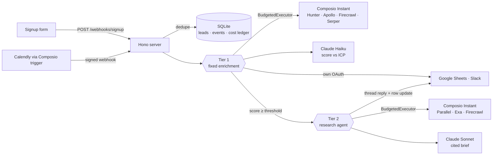

# Inbound Lead Enrichment Agent

**An agent that researches every new signup or demo booking for you.** A lead comes in through a webhook, and it verifies the email, enriches the person and company, reads their homepage and recent news, scores them against your ICP, writes a row to Google Sheets and pings Slack when the lead looks hot. Hot leads get a second research agent that posts a cited brief in the Slack thread.

Every paid data tool (Hunter, Apollo, Firecrawl, Serper, Parallel, Exa) runs on [Composio Instant](https://composio.dev): no provider accounts, no API keys, billed per call to one Composio wallet. Google Sheets and Slack run on your own OAuth connections, in the same session.

---

## What it does

| | |
|---|---|
| **No provider signups** | Six paid data providers through one Composio wallet. No Hunter, Apollo or Exa accounts, keys or billing pages. |
| **Fixed enrichment for every lead** | Email verify → person + company enrichment (Hunter first, Apollo only as a fallback) → homepage scrape → recent news → Claude score. Same calls every time, so the cost is predictable. |
| **Deep research for hot leads only** | Leads above `HOT_THRESHOLD` get a Claude research agent with Parallel, Exa and Firecrawl. It writes a short brief with sources. |
| **Your CRM and Slack** | One row per lead in Google Sheets, a Slack alert for hot leads and the research brief as a thread reply. |
| **Budget check before every paid call** | Each call reserves the tool's reviewed max price against a per-lead budget and a global cap. No room, no call. The real charge is settled afterwards. |
| **Mixed credentials, one session** | Paid tools go through `instant_account`, Sheets and Slack through `connected_account`. Every call is checked to make sure it used the account we expected. |
| **Kill switch** | One admin call stops all Instant spending, including sessions already in flight. Leads still land in the CRM and demo bookings still alert Slack. |
| **No paying twice** | Duplicate webhooks (same `event_id`, or same email within a window) are dropped before any paid work starts. |
| **Real cost per lead** | `npm run report` compares Composio's execution logs, the local ledger and the usage summary, per lead and per tier. |

## Architecture



- **Tier 1** runs on every lead and is a fixed sequence of calls. The model never picks tools here, so the worst-case cost per lead is known up front (`TIER1_BUDGET_USD`, default `$0.30`).
- **Tier 2** runs only for hot leads. Claude decides what to research, so it gets its own budget (`TIER2_BUDGET_USD`, default `$0.50`), a turn limit and argument clamping so a tool's price stays what we reviewed.
- **Sessions** are created per lead and per tier. The `instant` policy allows only the exact tools that tier needs, and the session IDs are stored with the lead so cost can be traced back from Composio's logs.

## Quickstart

**You need:** Node 22.22.3+, a [Composio](https://platform.composio.dev) project with Instant turned on and some wallet credit, an [Anthropic API key](https://console.anthropic.com), a Google Sheet with a `Leads` tab and a Slack channel.

```sh
git clone https://github.com/shricodev/composio-instant-lead-agent
cd composio-instant-lead-agent
npm install
cp .env.example .env               # fill in the keys
```

1. **Turn on Instant.** Composio dashboard → your project → Settings → **Instant Toolkits**. It's off by default.
2. **Use a project API key with `session_management: write`.** A read-only key passes discovery but fails session creation with `403 APIKey_InsufficientPermissions`.
3. **Keep `COMPOSIO_USER_ID` clean.** Use an ID with no connected accounts on the paid toolkits, or those accounts take priority over Instant.

**Check everything before spending** (both are free):

```sh
npm run discover        # Instant eligibility, published prices, price bounds, routing check
npm run verify-sdk      # session create/restore, kill switch, usage summary
```

**Connect Google Sheets and Slack:**

```sh
npm run connect                      # prints OAuth links
npm run lead -- --header --yes       # writes the CRM header row
npm run lead -- --slack-test --yes   # posts a test message (/invite the app first)
```

**Run one lead from the terminal:**

```sh
npm run lead -- --email you@yourcompany.com --name "Your Name" --source demo_booking
```

It prints the expected cost and stops. Add `--yes` to actually spend. Add `--tier1-only` to skip research.

**Or run it as a service:**

```sh
npm start

curl -X POST localhost:3000/webhooks/signup \
  -H 'content-type: application/json' -H "x-webhook-secret: $SIGNUP_WEBHOOK_SECRET" \
  -d '{"event_id":"evt_123","email":"jane@acme.io","name":"Jane Doe","source":"demo_booking"}'
# 202 {"status":"accepted","leadId":"lead_…"}  ·  send it again → 200 {"status":"duplicate"}
```

> **Privacy:** enrichment returns real people's data. Test with your own or your team's work emails, or public company contact addresses. `data/*.db` and `out/` are gitignored for that reason.

## Endpoints

| Route | |
|---|---|
| `POST /webhooks/signup` | Any form or signup flow. Body: `event_id`, `email`, `name?`, `company_name?`, `company_domain?`, `source` |
| `POST /webhooks/composio` | Composio trigger deliveries (Calendly `CALENDLY_MEETING_SCHEDULED`), signature-verified |
| `GET /health` | Liveness and kill-switch state |
| `GET /admin/leads/:id` | Lead status, results and per-call cost ledger |
| `GET/POST /admin/instant` | Kill switch: `{"enabled": false}` stops all Instant spending |
| `GET /admin/costs` | Ledger totals per tier and unresolved reservations |
| `POST /admin/reconcile` | Settle unresolved reservations from Composio's execution logs |

Admin routes need `Authorization: Bearer $ADMIN_TOKEN`.

## Configuration

Every option is documented in [`.env.example`](.env.example). The ones you'll most likely touch:

| Variable | Default | |
|---|---|---|
| `ANTHROPIC_MODEL` | `claude-haiku-5-5` | Lead scoring |
| `ANTHROPIC_RESEARCH_MODEL` | `claude-sonnet-5-5` | Tier 2 research |
| `TIER1_BUDGET_USD` | `0.30` | Max Instant spend per lead, enrichment |
| `TIER2_BUDGET_USD` | `0.50` | Max Instant spend per hot lead, research |
| `TIER2_MAX_ITERATIONS` | `6` | Model turns before the agent has to write the brief |
| `DEV_SPEND_CAP_USD` | `1.50` | Hard ceiling on total Instant spend |
| `HOT_THRESHOLD` | `75` | Score (0–100) that triggers Slack and research |
| `INSTANT_ENABLED` | `true` | Starting state of the kill switch |
| `DEDUPE_WINDOW_MINUTES` | `1440` | Same email inside this window is a duplicate |
| `CONCURRENCY` | `1` | Leads processed in parallel |

## Spend controls

- **Reviewed price bounds.** `data/tool_price_bounds.json` holds a max USD price per tool, taken from the published Instant prices. A tool with no bound is never called, and `npm run discover` fails if a published price changes.
- **Reserve → execute → settle.** Every paid call reserves its bound in a SQLite transaction against the per-lead budget and the global cap, runs, then settles the exact `instantCharge` (stored as bigint pico-USD, no floats).
- **Failure paths.** An empty wallet (`402`) stops the Instant steps but still writes the CRM row as `unenriched` and alerts Slack for demo bookings. A timeout keeps the reservation counted until the execution logs say what happened. Nothing is retried automatically.
- **Clamped arguments.** In Tier 2, arguments that change the price (Exa result count and content types, Parallel search mode, Firecrawl formats) are clamped before the call.
- **Optional Firewall.** `FIREWALL_ENABLED=true` adds Composio's prompt-injection check on Tier 2 tool results. It's a paid feature, so it's off by default.

Composio has no per-agent spend limit of its own, so these checks live in `src/budget.ts`.

## Project layout

```
data/            icp.md (scoring rubric) · crm_schema.md · sample_leads.json · tool_price_bounds.json
src/             config · composio (sessions + Instant policy) · tools (slug registry) · budget · store
                 money · killSwitch · reconcile · estimate · server · discoverTools
src/pipeline/    tier1 · scoring · tier2 · processLead
src/outputs/     crm (Google Sheets) · slack
src/scripts/     connect · verifySdk · runLead · runSample · reportCosts · setupCalendly
test/            vitest suites for money, budget, store, domain, tier1, tier2, server, reconcile
```

Findings from building it, including SDK and docs differences and the real prices observed, are in [BUILD_NOTES.md](BUILD_NOTES.md).

## Development

```sh
npm run typecheck && npm test      # no network, no spend
npm run sample -- --limit 3        # data/sample_leads.json, prints the estimate first
npm run report                     # real cost per lead from Composio's logs
npm run calendly                   # optional: connect Calendly and create the trigger
```

The test suite uses fakes for every Composio and Anthropic call, so it never touches the wallet.

## Roadmap

- HubSpot as a CRM option alongside Google Sheets
- More lead sources through Composio triggers
- A small dashboard for cost per lead over time
